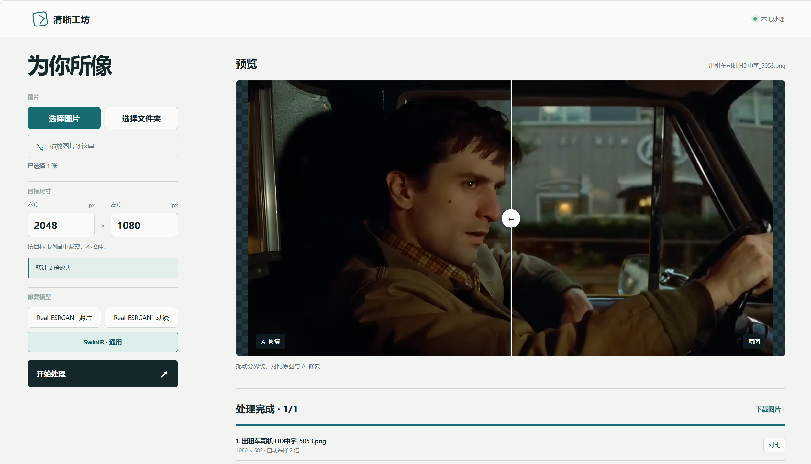

# 清晰工坊：本地图片放大与 AI 修复

在本地网页中选择图片、目标尺寸和修复模型，自动完成等比例放大、AI 修复及居中裁剪。支持文件夹批量处理，并可拖动分界线对比原图和处理结果。



支持 [Real-ESRGAN](https://github.com/xinntao/Real-ESRGAN) 照片与动漫模型，以及 [SwinIR](https://github.com/JingyunLiang/SwinIR) 真实图片模型。命令行还可以生成 Lanczos 插值对照图。

## 环境

- Windows 10/11、Python 3.10+。
- Real-ESRGAN 需要支持 Vulkan 的显卡及驱动，首次使用会下载约 45 MB 的官方推理程序和模型。
- SwinIR 使用 PyTorch；推荐 CUDA 显卡，本机 CUDA 不可用时也能使用 CPU，但处理会慢很多。首次使用会下载约 64 MB 的官方权重。两种模型下载完成后都可以离线运行。

## 运行

```powershell
python -m pip install -r requirements.txt
python upscale.py "D:\图片\示例.jpg" --scale 2 --model photo
```

插画可以选择 `--model anime`；真实图片也可以试试 `--model swinir`。`--scale` 支持 1 到 4 的数值，例如 `1.5`、`2`、`4`。默认结果保存在 `output` 目录；可通过 `--output` 指定目录。SwinIR 默认按 128 像素分块处理，`--tile` 可调整分块大小。

程序会输出 `*_lanczos.png` 和 `*_ai_<模型>.png`。两张图的宽、高和格式一致。AI 模型先以 4 倍处理图片，再以 Lanczos 缩至指定倍率；因此小于 4 倍时也会运行完整的 AI 推理。

AI 生成的纹理是推测结果，尤其要检查人脸、文字和细小图案是否符合原图。

SwinIR 使用官方仓库的 real-world x4 GAN 中型模型，按小块推理以控制显存占用。其网络实现保存在 `third_party/swinir/network_swinir.py`，原项目 Apache 2.0 许可见同目录 `LICENSE`。

## 本地网页与文件夹批量处理

安装依赖后启动网页服务：

```powershell
python -m pip install -r requirements.txt
python webapp.py
```

在浏览器打开 <http://127.0.0.1:5000>。可以选择一张或多张图片，也可以选择整个文件夹；浏览器会上传文件夹内的 PNG、JPEG、WebP 图片到本机服务。目标尺寸默认是 2048×1080 像素，可自行修改。可以选择 Real-ESRGAN 照片、Real-ESRGAN 动漫或 SwinIR 通用模型。网页任务只保存最终 AI 图片，文件名为原文件名加 `AI.png`，例如 `照片.jpg` → `照片AI.png`。单张图片直接下载 PNG；文件夹或多张图片下载 ZIP，压缩包中每张输入图片只有一张最终 AI 结果。

网页会按每张图片的目标宽高比估算最大可用裁剪区域，然后选足够大的 1、2 或 4 倍中间尺寸，最后居中裁剪并缩小到精确目标尺寸。即使选中多张不同大小的图片，每张也会单独计算倍率。若目标需要超过 4 倍放大，或目标超过 6000 万像素，会明确报错。AI 引擎内部使用 4 倍模型；当中间尺寸选择 1 或 2 倍时，会从模型输出缩小到该尺寸。

网页只监听本机地址 `127.0.0.1`，输出保存在 `output/web/`，临时上传文件保存在 `.cache/jobs/`。关闭服务后已生成的图片仍在磁盘上；任务进度记录只在服务运行期间保留。

## 放大后的裁剪微调

可以在放大命令末尾直接追加最终像素尺寸。程序先按目标宽高比从中央裁剪，再使用 Lanczos 缩小到精确尺寸；普通放大图和 AI 图都会各生成一份 `_refined.png`：

```powershell
python upscale.py "图片.png" --scale 2 --model photo --refine-width 1920 --refine-height 1080
```

如果只想调整宽高比、尽量保留像素，不指定最终尺寸：

```powershell
python upscale.py "图片.png" --scale 2 --model photo --refine-ratio 16:9
```

对已经放大的图片，也可以单独运行微调工具：

```powershell
python refine.py "output\图片_ai_photo.png" --width 1920 --height 1080
python refine.py "output\图片_ai_photo.png" --ratio 1:1
```

默认从中央裁剪。可用 `--focus-x 0` 保留左侧、`--focus-x 1` 保留右侧；`--focus-y 0` 保留顶部、`--focus-y 1` 保留底部。两项都支持 0～1 之间的小数。裁剪微调只会保留原尺寸或缩小；目标尺寸超过裁剪后可用像素时会报错，不会插值放大。

## 许可

本项目的原创代码使用 [MIT 许可证](LICENSE)。`third_party/swinir/` 中的官方网络实现保留其 [Apache 2.0 许可证](third_party/swinir/LICENSE)。页面截图仅用于展示界面，其中的示例图像不作为可复用素材提供。
